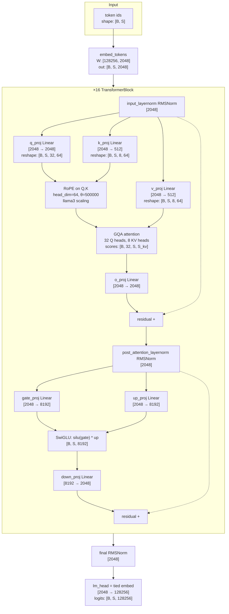
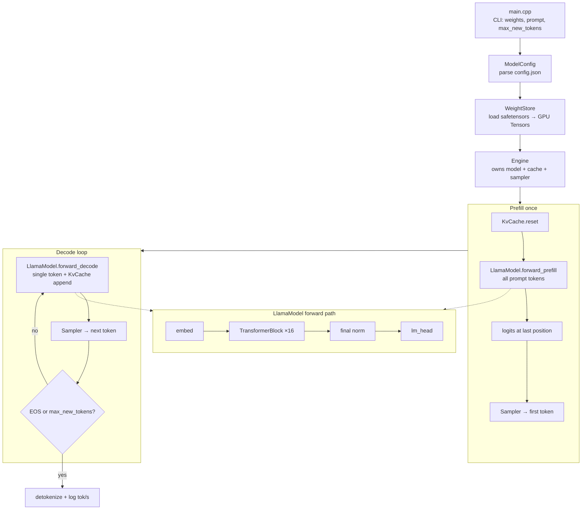

# Inference

Solo CUDA/C++ decode runtime for **Llama-3.2-1B-Instruct**.

## Model architecture (Llama-3.2-1B)

Dimensions from `weights/config.json`: `vocab=128256`, `d_model=2048`, `n_layers=16`, `n_heads=32`, `n_kv_heads=8`, `head_dim=64`, `intermediate=8192`. Embeddings and `lm_head` are tied.

**GQA note:** `k_proj`/`v_proj` emit `8 × 64 = 512` channels; each KV head is shared by `32/8 = 4` query heads.

## Engine workflow

### Module roles

| Module | Responsibility |
|---|---|
| `ModelConfig` / `WeightStore` | Hyperparams + named GPU weights |
| `LlamaModel` / `TransformerBlock` | Graph wiring |
| `Linear` / `RMSNorm` / `RoPE` / `Attention` / `MLP` | Ops (`kernels/*.cu` + `CublasGemm`) |
| `KvCache` / `Sampler` / `Engine` | State + prefill/decode control |
| `python/scripts/serve_transformers.py` | Reference generate for verification |
